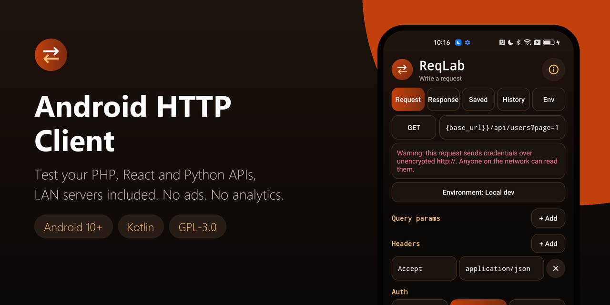
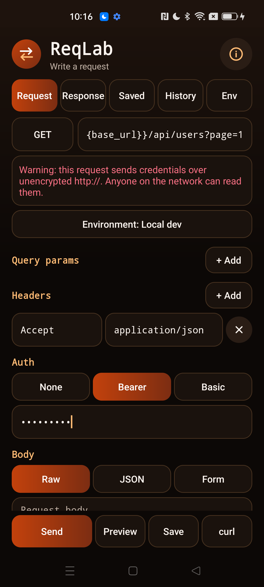
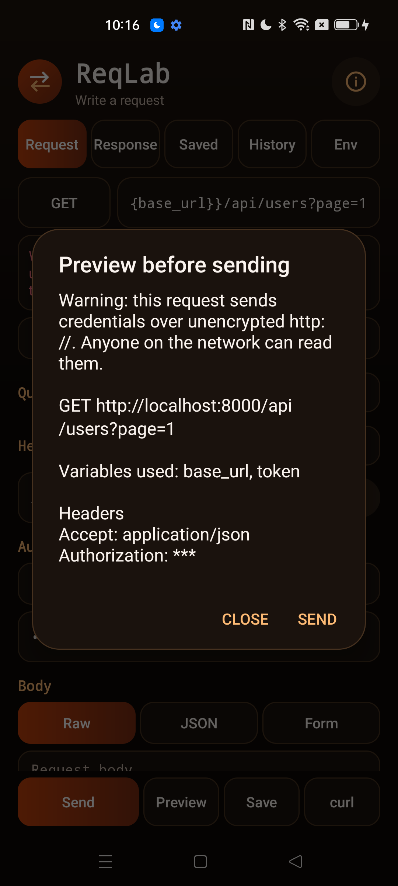
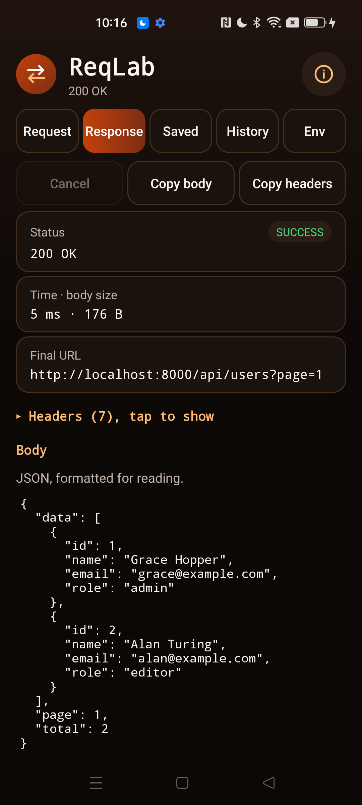
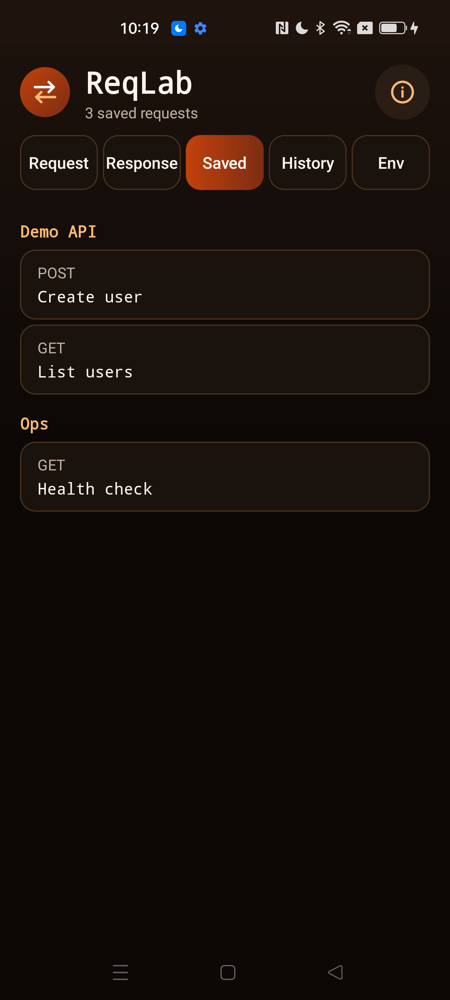
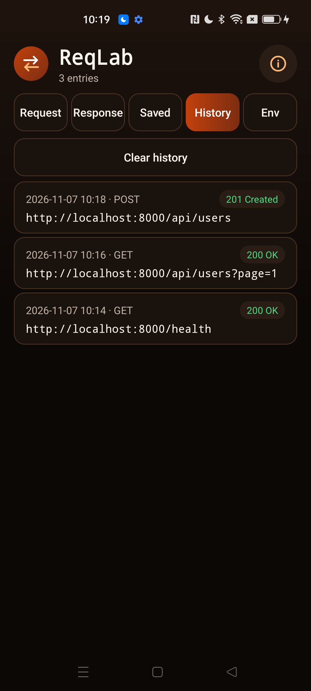
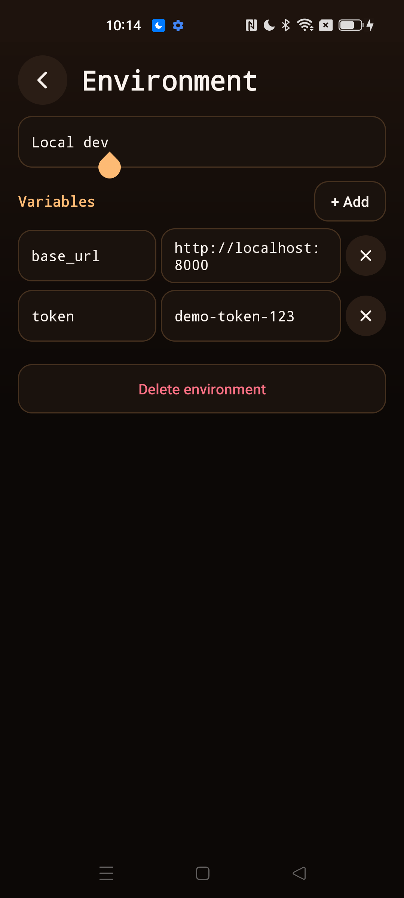

<div align="center">



# Android HTTP Client

**Test your PHP, React and Python APIs from your phone, including servers on your LAN. Environments, saved requests, curl export and encrypted storage. Open source, no ads, no analytics.**

[](LICENSE)
[](#requirements)
[](https://kotlinlang.org)
[](app/build.gradle.kts)
[](app/src/main/AndroidManifest.xml)
[](https://github.com/Nekuzaky/android-http-client/stargazers)

</div>

Android HTTP Client ships an app called **ReqLab**. It is a developer tool that sends the HTTP requests you write to the servers you choose, with no account and nothing sent anywhere else.

## Screenshots

<p align="center">
  
  
  
</p>
<p align="center">
  
  
  
</p>

Every screen of the app blocks screenshots and the Recents preview. To take these images, the call that sets that block was turned off in a temporary local build. That build was used only for the screenshots and was reverted right after. The data is fake, served by a local test server.

## Features

- **Methods:** GET, POST, PUT, PATCH, DELETE, HEAD and OPTIONS
- **Request:** URL, query params, a headers editor, and a raw, JSON or form-urlencoded body
- **Auth helpers:** bearer token and basic auth
- **Response:** status, time, size, headers, and a body that is pretty-printed when it is JSON
- **Sending:** on a background thread with connect, header, read and overall time limits, and a Cancel button
- **Redirects:** not followed by default, with a switch to follow them
- **Environments:** variables such as `{{base_url}}`, with the substitution shown in a preview before sending
- **Saved requests:** grouped in collections
- **History:** with a clear button
- **curl export:** a correctly quoted command, with a masked copy that hides secrets
- **Copy:** long press a response value to copy it
- No ads, no analytics, no account and no third-party libraries

## How it works

The app builds each request from what you typed in one pure Kotlin step. Variables are substituted once and never expanded again, and the result is validated after substitution, so a variable cannot smuggle in something the fields would refuse.

A preview opens before sending when the request uses variables or has a warning. The Preview button shows it at any time. Requests go through the Android `HttpURLConnection` with a fixed set of limits:

| Limit | Value |
| --- | --- |
| Connect timeout | 10 seconds |
| Read timeout | 30 seconds |
| Response headers | Must arrive within connect plus read time, and stop if memory grows by more than 64 MiB while they arrive |
| Whole request | 2 minutes |
| Response body read | 2 MiB, then marked as cut |
| Text in one field | 64,000 characters. A larger paste is refused whole, with a message |
| Request body sent | 2 MiB after substitution |
| Redirects followed | 5 |

## Privacy and security

- The only permission is `INTERNET`. Requests go to the servers you enter and nowhere else.
- No analytics and no logging.
- Backups are off, and `dataExtractionRules` excludes everything from cloud backup and device transfer.
- Only the launcher activity is exported, and it reads nothing from its intent.
- Buttons ignore touches when another window covers them.
- Screenshots and the Recents preview are blocked on every screen (`FLAG_SECURE`), because requests and responses can hold secrets.
- Text fields ask the keyboard not to learn, suggest or correct, so it does not rewrite URLs or tokens.

**At rest:**

- Saved requests, the working draft, environment values and history are encrypted with AES-GCM, using a key held in Android Keystore.
- If encryption fails, nothing is written. There is no plaintext fallback.
- A file that cannot be read or decrypted is moved aside and not overwritten.
- History does not store bodies, auth values, or `Authorization` and `Cookie` headers.
- Clipboard copies of curl commands with secrets and of response data are flagged sensitive, which hides the preview on Android 13 and later.

**On the wire:**

- Only `http` and `https` are allowed. URLs with credentials in them, backslashes or control characters are refused.
- Cleartext `http://` works because dev servers use it, and a visible warning appears on any `http://` request that carries credentials.
- TLS validation is always on and cannot be turned off. Only system certificates are trusted.
- A line break in a header name or value refuses the request and explains why, including when it comes from a variable.

**On a redirect you chose to follow:**

- Only a short list of harmless headers (such as `Accept` and `User-Agent`) goes to another origin. Everything else, including all auth headers, is dropped, and the response lists what was dropped.
- A redirect that would repeat POST, PUT, PATCH or DELETE on another origin, or resend a body there, is not followed.
- A public server cannot redirect the request to a private address. The response explains why it stopped.

**Responses are treated as hostile input:**

- Bodies are plain text and never rendered as HTML. There is no WebView.
- Control, bidi and invisible characters are removed from everything shown, and lengths are capped.
- JSON is formatted by an iterative parser with a depth limit, so deep nesting cannot overflow the stack.

### Permissions

| Permission | Why it is needed |
| --- | --- |
| `INTERNET` | To send the requests you write |

## Requirements

- Android 10 (API 29) or later
- JDK 21 and Android SDK 35 to build from source

Gradle 8.11 does not support the Java 25 runtime bundled with recent Android Studio versions, so use a separate JDK 21.

## Download

Download the signed APK from the [latest release](https://github.com/Nekuzaky/android-http-client/releases/latest) and open it on your phone. Android may ask you to allow installs from the app you opened it with.

The release notes list the SHA-256 checksum of the APK and of its signing certificate.

## Build from source

A build signed with your own key cannot install over the release APK, so uninstall the app first.

```bash
git clone https://github.com/Nekuzaky/android-http-client.git
```

```bash
cd android-http-client
```

Create a `local.properties` file that points to your Android SDK:

```properties
sdk.dir=/path/to/Android/Sdk
```

Build a debug APK with JDK 21. No signing setup is needed:

```bash
JAVA_HOME=/path/to/jdk-21 ./gradlew assembleDebug
```

Run the unit tests:

```bash
JAVA_HOME=/path/to/jdk-21 ./gradlew testDebugUnitTest
```

Install it on a phone with USB debugging enabled:

```bash
adb install -r --user 0 app/build/outputs/apk/debug/app-debug.apk
```

### Signed release build

Create a signing key, then add a `keystore.properties` file at the project root. It is ignored by Git, so never commit it or your key:

```properties
storeFile=/path/to/your-key.jks
storePassword=your-password
keyAlias=release
keyPassword=your-password
```

```bash
JAVA_HOME=/path/to/jdk-21 ./gradlew assembleRelease
```

Without `keystore.properties` the build still works, and `assembleRelease` produces an unsigned APK.

## Limitations

- **Self-signed and private CA certificates are refused**, including mkcert and user-installed CAs. Use `http://` on a trusted network, or a publicly trusted certificate.
- **No screenshots.** The app blocks them on every screen, so you cannot capture a response from the phone. Copy it instead.
- **Fields hold up to 64,000 characters.** Android lays out long text on the main thread, and on the test phone a 120,000-character paste with no line breaks froze the app. Variables can still make a body of up to 2 MiB.
- **Masking is by name and position.** Header names, query names, form field names and variables that look sensitive are masked. A secret under an unusual name, or inside a JSON body, can still show in the preview and in "Copy masked". History never stores bodies.
- **Replaying from history.** Masked values come back as `***` and must be typed again. Bodies and auth are not kept.
- **Private address detection uses the host text.** A public name that resolves to a private address is not detected.
- **A body typed on GET, HEAD or OPTIONS is ignored**, with a warning.
- **Non-ASCII header values are refused.** Percent-encode them first.
- **`Content-Length` and `Transfer-Encoding` are refused** as custom headers, because the platform sets them.
- **Binary responses are not displayed.** The app reports the size and says the body looks binary.
- **Header flood protection is a safeguard, not a size cap.** The Android client reads response headers with no size limit. The app stops a request on the header time limit, or when memory grows by 64 MiB while headers arrive.
- **Responses are kept in memory only**, so the last response is gone if Android kills the app. The draft comes back.
- **curl commands use POSIX shell quoting**, for bash and zsh. They are not written for Windows `cmd`. `--location` is left out when custom headers could follow a redirect to another host.
- **Nothing can be imported**, by design.

## Test status

Unit tests for the current source: 291 pass under `testDebugUnitTest`, on the JVM. They cover URL parsing, header rules, substitution, masking, JSON formatting, curl quoting, redirects, storage with corrupt and oversized files, and the HTTP engine against local loopback servers, including a self-signed TLS server and endless response headers. Lint reports no errors.

An earlier version of the curl quoting was also run through a real bash with a stub `curl`, on 19 hostile bodies. All arrived byte-exact and nothing was injected.

Tested with the current debug build on one phone: Oppo Reno4 Z 5G, Android 12, ColorOS. Requests went to a local test server through `adb reverse`, and to public hosts.

| Check | Result |
| --- | --- |
| GET, POST, PUT, PATCH, DELETE with a body, HEAD and OPTIONS, compared with the server log | Method and body arrived as sent |
| 404, 500 and 204 responses | Status and body correct |
| JSON and HTML responses | JSON formatted, HTML shown as plain text |
| Binary response | Reported as binary, not shown |
| Bidi and control characters in a response | Removed |
| 400 response headers | First 200 shown, with a note |
| `file:`, `ftp:`, `javascript:`, a URL with credentials, a bad port and no scheme | Refused, with a reason |
| Closed port and unknown host | Clear error |
| `self-signed`, `wrong.host` and `expired` hosts on badssl.com, and `https://` to a plain HTTP port | Refused as TLS failures |
| Real HTTPS: httpbin.org, google.com and iana.org | Works |
| Redirect off, redirect on, redirect to `file:`, and a redirect loop | Not followed, followed, refused, and stopped after 5 |
| Cross-origin 302 with a bearer token, `X-Functions-Key`, a custom header and `Accept`, compared with the second server log | Only `Accept` arrived, and the response lists what was dropped |
| Cross-origin 307 with a body, and with DELETE | Not followed |
| A public redirector sending the request to `127.0.0.1` and to `192.168.1.1` | Not followed, and nothing reached the local server |
| Cleartext warning on `http://` with auth, and none on `https://` | Works |
| 3 MiB body | Cut at 2 MiB and marked |
| 1.14 MiB JSON and a 1.43 MiB body with no line breaks | Shown and scrolled, no crash |
| Server sending endless response headers | Stopped after about 5 seconds. The server had sent over 300 MB by then, and the Java heap peaked near 78 MB. No crash |
| Server sending one header every 0.2 seconds | Stopped by the header time limit |
| Cancel during a slow response and during a slow body | Stopped at once and recorded as cancelled in history |
| Rotation during a send | The response arrived |
| Rotation with fields filled in, and with a 64,000-character body | Fields kept |
| Process killed in the background | The draft, including the token, came back |
| Pasting a 9,000-character URL, header value and token | Kept whole and refused with a reason. Nothing was sent |
| Pasting 256,000 characters into the body | Refused whole, with a message |
| Line break typed in a header value | Refused with the injection explanation. Nothing was sent |
| Environment with variables, after rotation, used in the URL, a header and the token | Substituted, shown masked in the preview, and sent |
| Unknown variable | Refused inline |
| "Copy masked" and "Copy with secrets" from the curl dialog, pasted back | Masked copy holds `***`, the other the real values |
| Save dialog during rotation, then reload after the process was killed | Name kept, request reloaded |
| `saved.json`, `draft.json`, `environments.json` and `history.json` read with `run-as` | Encrypted envelopes. No token, URL, header or body in plain text |
| Clear history | File removed |
| All four files replaced with garbage | App started empty, files moved aside as `.corrupt`, no crash |
| `FLAG_SECURE` | Set on the window, and `screencap` returns nothing on the app and on Recents |
| Direct launch of the environment screen from ADB | Refused |
| Safe monkey run, 2000 touch events | No crash and no ANR |

During these checks, `example.com` failed to resolve. The phone's own `ping` and a PC on the same network failed too, while `1.1.1.1` resolved it, so the cause is the home router's DNS, not the app.

**Not tested:**

- The sensitive clipboard flag, which only has an effect on Android 13 and later
- The Recents thumbnail as a picture. Only the failed screen capture was checked
- Basic auth and form bodies against a server. They are covered by unit tests only
- A public host name that resolves to a private address
- Signed release builds, other brands, Android 10, 11, 13 and later, tablets, and work profiles

If something breaks on your phone, please open an issue.

## Related

- [Android APK Inspector](https://github.com/Nekuzaky/android-apk-inspector): see how any installed app is built.
- [Android App Firewall](https://github.com/Nekuzaky/android-app-firewall): cut Internet access per app.
- [Android Permission Manager](https://github.com/Nekuzaky/android-permission-manager): see what every app can access.
- [Android Tracker Detector](https://github.com/Nekuzaky/android-tracker-detector): find tracking code inside your apps.
- [Android Network Monitor](https://github.com/Nekuzaky/android-network-monitor): see the traffic of your apps.

## License

Distributed under the [GNU General Public License v3.0](LICENSE).
